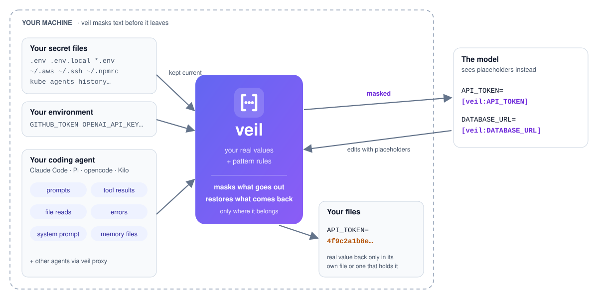

<p align="center">
  <picture>
    <source media="(prefers-color-scheme: dark)" srcset="docs/assets/logo-dark.svg">
    
  </picture>
</p>

<p align="center"><strong>Masks your secrets before your coding agent's model sees them.</strong></p>

<p align="center">
  <a href="https://github.com/goncaloneves/veil/actions/workflows/ci.yml"></a>
  <a href="https://github.com/goncaloneves/veil/releases"></a>
  <a href="LICENSE"></a>
  
  
</p>

<p align="center">
  <a href="#install">Install</a> ·
  <a href="#how-it-works">How it works</a> ·
  <a href="#what-it-reads">What it reads</a> ·
  <a href="#configure">Configure</a> ·
  <a href="#commands">Commands</a> ·
  <a href="#what-veil-cannot-do">Limits</a>
</p>

Coding agents read your files and run your commands, and everything they see goes to the model and into the session file on disk: the `.env` they open, the `docker inspect` they run, the key you paste into a prompt. veil sits inside the agent and swaps each secret for a named placeholder before any of that happens.

```text
$ cat .env                                    # what runs on your machine
API_TOKEN=4f9c2a…
DATABASE_URL=postgres://app:hunter2…@db:5432/app

API_TOKEN=[veil:API_TOKEN]                    # what the model reads, and the transcript keeps
DATABASE_URL=[veil:DATABASE_URL]
```

## Why veil

- 🔑 **It knows your real values, not just key formats.** veil reads the secrets you already keep and masks those exact values wherever they show up: shell output, logs, `docker inspect`, error messages, even base64-encoded or JSON-escaped. Pattern-only scanners miss a plain password, a custom token or one line of a private key.
- 🧭 **It also catches secrets it has never seen.** The [gitleaks](https://github.com/gitleaks/gitleaks) rule set, kept current every week, plus veil's own rule for passwords inside URLs.
- 🛡️ **It covers the paths to the model.** Prompts, tool results and errors, Claude's own text, the system prompt and `CLAUDE.md`, attachments, skills, slash-command arguments, messages between sessions, and the records the screen and the session file keep.
- ✍️ **Claude still works with your secrets.** Placeholders keep their names, and when Claude edits the file a secret came from, veil writes the real value back into that edit, and nowhere else.
- 🏠 **Nothing leaves your machine.** No network calls, no processes, no model calls. Real values live in memory for the session and are never written or logged.

## How it works

<p align="center">
  <picture>
    <source media="(prefers-color-scheme: dark)" srcset="docs/assets/architecture-dark.svg">
    
  </picture>
</p>

1. **Read once.** When a session starts, veil reads the secrets you already keep: your project's `.env` files, the credentials in your home folder and well-known API keys in the environment.
2. **Mask everything that goes out.** Every text the agent sends to the model or stores in its session file passes through veil first. Each known value, and anything a pattern rule recognises, becomes a named placeholder such as `[veil:API_TOKEN]`.
3. **Restore only where it belongs.** When Claude edits a file with a placeholder in it, veil writes the real value back only into the file that value came from, or one that already holds it. Anything else is refused, so a prompt injection cannot plant your secret somewhere it can send it from.

veil works with **Claude Code** today, in the terminal, the VS Code and Cursor extension, and the desktop app. Its core is agent-neutral, built for adapters to other agents; see [docs/ARCHITECTURE.md](docs/ARCHITECTURE.md).

## Install

In a Claude Code session in the terminal:

```text
/plugin install veil --marketplace goncaloneves/veil
```

Answer `y` to add the marketplace, then pick the user scope. Or from a shell:

```sh
claude plugin marketplace add goncaloneves/veil
claude plugin install veil@veil
```

In the desktop app, click **+** next to the prompt box, then **Plugins**, **Add marketplace** with `goncaloneves/veil`, then **Add plugin**.

veil starts in every new session. Run `/veil` in a session to see what it reads and what it masked. [INSTALL.md](INSTALL.md) covers updates, the command-line tool and uninstalling.

## What it reads

| Source | What veil takes from it |
| --- | --- |
| `.env`, `.env.*`, `*.env` and `.envrc` in the project and the working folder, two folders deep | values behind secret names, credentials inside URLs, and random-looking values. A strong name, one whose last part is `PASSWORD`, `SECRET`, `PASSCODE`, `PW` or `PIN` (a trailing `_PROD`, `_DEV` or similar is ignored), is masked whatever its value, except `true`, `false` and the like. A weak name, one whose last part is `KEY`, `TOKEN`, `AUTH` or `SESSION`, or that holds a strong word elsewhere (`PASSWORD_MIN_LENGTH`), is masked unless its value is a number, a path, a URL with no credentials, or plain lowercase words such as `us-east-1` or `argon2id`. Never `NODE_ENV`, `PORT`, `NEXT_PUBLIC_*` or `.env.example` |
| `~/.aws/credentials` | access keys and session tokens |
| `~/.ssh/*` | private keys, whole and line by line |
| `~/.config/gh/hosts.yml`, `~/.git-credentials`, `~/.netrc` | GitHub and git tokens, passwords |
| `~/.npmrc`, `~/.docker/config.json`, `~/.pgpass`, `~/.kube/config` | registry tokens, decoded passwords, database and cluster credentials |
| the agent's environment | `ANTHROPIC_API_KEY`, `OPENAI_API_KEY`, `GITHUB_TOKEN`, `DATABASE_URL` and 33 more well-known names |
| files you list in the config | any dotenv-style file, such as `~/.config/myapp/*.env` |

Values shorter than 8 characters are never masked, so ordinary words stay readable. A weak-named variable whose value is plain words, such as `JWT_KEY=mysecretkey`, is not masked either; name it in `[env] secret_keys` to change that. Each value is also matched in its base64, base64url, URL-encoded and JSON-escaped forms, and a multi-line value such as a private key line by line. Symlinked files are followed; named pipes, such as a 1Password-mounted `.env`, are never opened.

## How Claude Code is covered

| Where a secret could reach the model | How veil covers it |
| --- | --- |
| a prompt you type or paste into | masked before the turn starts; if veil cannot check it, it is not sent |
| a tool's result: a file read, shell output, an MCP or web result | masked in the tool's own record and again in the row the model reads |
| a tool's error, such as a failing command's output | replaced by a masked error before it is stored |
| Claude's own text | masked before it is stored |
| the system prompt, `CLAUDE.md` and memory files | masked in each section and context block |
| a reminder the agent attaches | masked as it is attached |
| a file you @-mention | refused when it holds a secret, since Claude Code stores a mention as read; Claude reads it with its Read tool instead, which veil masks |
| a skill's body, a slash command's arguments | masked before they run |
| a message to or from another session or subagent | masked in both directions |

veil fails closed and stays inside Claude Code's time limits. A row it cannot check in time is replaced with a notice, a prompt it cannot check is not sent, and a message it cannot check is not delivered.

## Writing secrets back

When Claude edits a file, veil turns placeholders back into real values only in the file the secret came from, or in a file that already holds that value. An edit that would put a known secret anywhere else is refused, with the reason, so a prompt injection cannot get Claude to plant a secret where it could send it out. Placeholders in shell commands always stay placeholders.

veil never writes a placeholder where it would replace real content. A placeholder it cannot resolve, a value that has since changed in your secret files, or any placeholder while `[restore] mode` is `never` is refused, unless the file already holds that exact placeholder text, as documentation might. A key you paste into a prompt belongs to no file, so Claude cannot write it into a new `.env` for you; add it yourself, or set `[restore] mode = "always"` to restore into any file.

## Configure

Every setting is optional. `veil config init` writes a starter file, or create one yourself at `~/.config/veil/config.toml` (on macOS, `~/Library/Application Support/veil/config.toml` works too). `VEIL_CONFIG` names any other absolute path outside your projects:

```toml
[sources]
project = true          # .env files in the project, up to project_depth folders down
project_depth = 2
home = true             # ~/.aws, ~/.ssh keys, gh, docker, npm, netrc, pgpass, git and kube credentials
environment = true      # well-known API key variables in the agent's environment
files = ["~/.config/myapp/*.env"]

[env]
secret_keys = ["*_DSN"]               # more variable names to treat as secret
ignore_keys = ["SENTRY_ENVIRONMENT"]  # variable names never treated as secret

[rules]
gitleaks = true
disable = []            # rule ids to turn off, such as "generic-api-key"

[mask]
min_length = 8
encodings = ["base64", "url", "json", "lines"]

[restore]
mode = "holding"        # holding, always or never
```

An invalid value falls back to its default with a warning, so a typo never turns masking off. Any setting that weakens protection is named in a warning at the start of every session and in `/veil`. Run `/veil reload` after editing the file.

## Commands

In a session:

| Command | What it does |
| --- | --- |
| `/veil` | what veil reads, how many values and rules are active, and what it masked this session, by name, never by value |
| `/veil reload` | read the config and your secret files again |

From a shell, after installing the [command-line tool](INSTALL.md#command-line-tool):

| Command | What it does |
| --- | --- |
| `veil scan [file …]` | print files, or stdin, with secrets masked; exits 1 when it masked something |
| `veil sources` | list the secret files veil reads, with names and counts, never values |
| `veil config [path\|show\|init]` | where the config is, the settings in effect, or a starter file |
| `veil doctor` | check the config, the sources, the rules, the Claude Code version and the plugin |
| `veil init` | install the Claude Code plugin |

`veil scan` works as a filter anywhere: `kubectl logs api | veil scan`.

## What veil cannot do

> [!WARNING]
> veil restores a value into an edit before Claude Code's permission step checks that edit, so in auto mode its permission classifier, and an approval card shown through Remote Control, can see the real value. If you use either, set `[restore] mode = "never"`.

- **Change what your programs see.** Commands Claude runs still read real values, as they need to. veil changes only what reaches the model.
- **Catch a secret it does not know and that has no known format,** such as a short password typed into a prompt.
- **Catch a value transformed in other ways,** such as split across lines, hex-encoded or reversed. A pattern-matched token longer than 8 KB on a line longer than 32 KB can also slip between scan windows; a known value is matched anywhere.
- **Reach text Claude Code adds after plugins run:** a prompt passed with `--append-system-prompt` is sent as written.
- **Rewrite a few records Claude Code pins:** thinking blocks and the tool calls Claude writes. They only ever hold what Claude was shown, which veil masked.
- **Hide a value from the screen before it is masked.** Claude Code notes that the screen, an SDK stream or Remote Control may show a row just before plugins rewrite it. The model and the session file never read that form.

> [!IMPORTANT]
> veil is a strong second layer, not the first. Keep secrets out of reach in the first place: Claude Code's [deny rules](https://code.claude.com/docs/en/permissions) for `.env` and `~/.ssh` stop the reads veil would otherwise have to mask.

## Works well with

- **[rtk](https://github.com/rtk-ai/rtk)** shrinks command output; veil masks what is left. They run side by side.
- **Deny rules** in `~/.claude/settings.json` block the reads; veil catches what still gets through.

## Agents

| Agent | Status |
| --- | --- |
| Claude Code 2.1.287 or later (terminal, VS Code and Cursor extension, desktop app); tested on 2.1.308 and 2.1.316 | supported |
| Codex, OpenCode, Pi, GitHub Copilot CLI | planned: the core in `src/core`, `src/sources` and `src/config` takes no agent or runtime dependency, so each adapter is a thin layer over it |

See [docs/ARCHITECTURE.md](docs/ARCHITECTURE.md) for how an adapter plugs in.

## Development

```sh
npm ci
npm test                    # unit tests, Node's own runner
npm run typecheck           # the core is checked with no Node or DOM types
claude plugin validate .    # what the Claude Code adapter hooks and calls
claude plugin test .        # the adapter's tests, inside Claude Code's runtime
claude --plugin-dir .       # try your working copy in a session
```

veil has no runtime dependencies. [CONTRIBUTING.md](CONTRIBUTING.md) has the conventions, and [SECURITY.md](SECURITY.md) how to report a vulnerability.

## License

[MIT](LICENSE). The pattern rules are converted from [gitleaks](https://github.com/gitleaks/gitleaks), MIT licensed; see [NOTICE](NOTICE).
